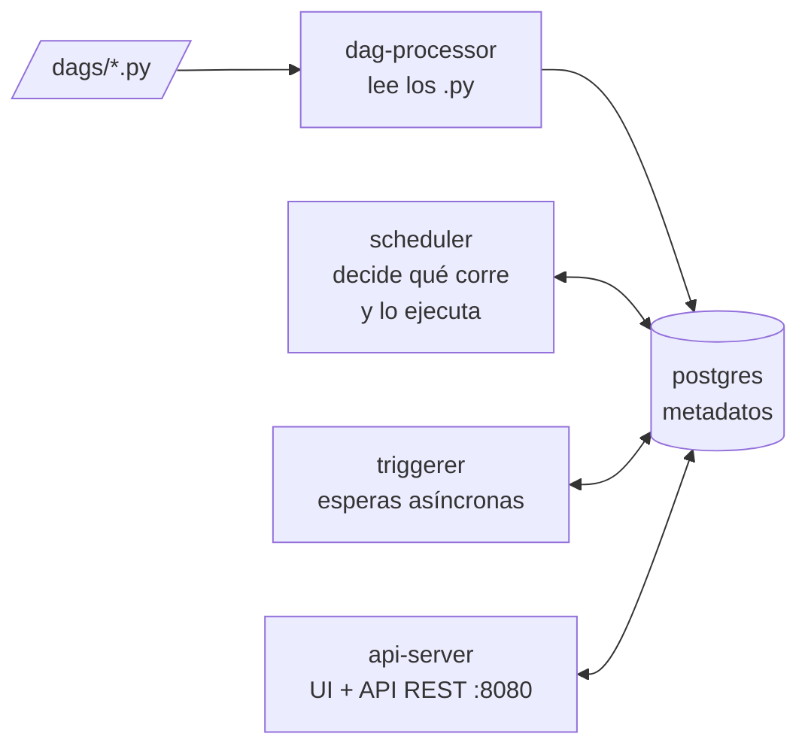
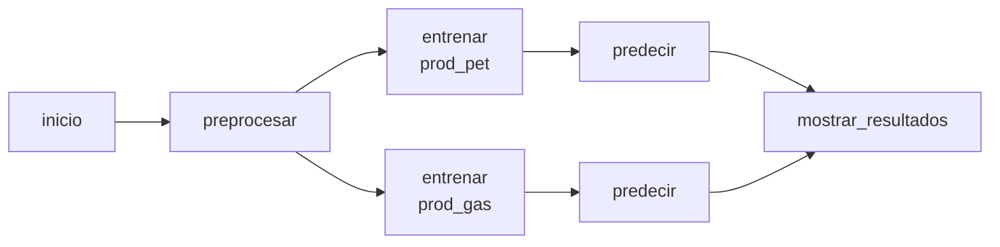
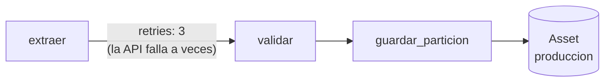
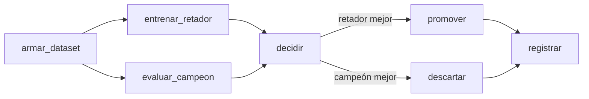
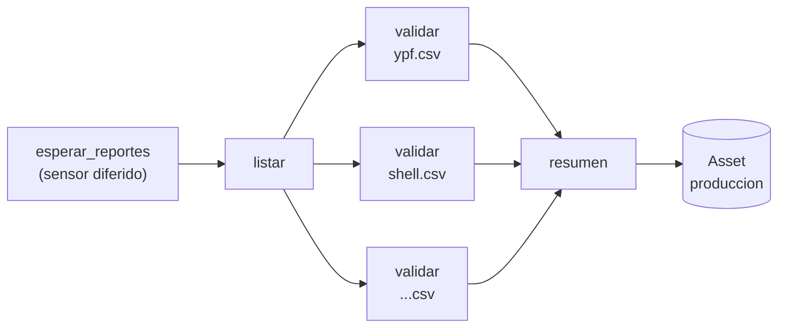

# Guía: Apache Airflow

Airflow **no procesa datos**: decide *qué* corre, *cuándo* y *en qué orden*, reintenta lo que falla y deja registro de todo. El trabajo lo hacen las tareas (en esta clase, funciones de Python con pandas y scikit-learn).

Cuatro DAGs, cuatro formas de dispararse:

| DAG | Pregunta que responde | Disparo |
|---|---|---|
| `01_ml_manual` | ¿Cómo se arma un pipeline? | manual, con formulario |
| `02_ingesta_mensual` | ¿Cómo proceso "cada mes" sin duplicar ni perder meses? | calendario |
| `03_reentrenamiento` | ¿Cómo reacciono a datos nuevos, venga de donde venga? | datos (Asset) |
| `04_reportes_de_campo` | ¿Cómo espero algo que pasa afuera de Airflow? | evento externo (sensor) |

---

## 1. Levantar todo

```bash
docker compose down -v      # (opcional) arrancar de cero
docker compose up -d
```

Abrir **http://localhost:8080** → usuario `airflow`, contraseña `airflow`. Tarda ~1 minuto.

### Qué levanta



| Servicio | Qué hace |
|---|---|
| `postgres` | Guarda **todo** el estado: DAGs, ejecuciones, estados de tareas, XComs. |
| `airflow-dag-processor` | Lee la carpeta `dags/` cada 10 s. Si un `.py` tiene un error, aparece arriba en la UI. |
| `airflow-scheduler` | Mira qué tiene que correr y lo corre. Con `LocalExecutor`, las tareas son procesos dentro de este contenedor (en producción: Celery o Kubernetes). |
| `airflow-triggerer` | Hace las esperas largas (sensores diferidos) sin ocupar workers. |
| `airflow-apiserver` | La UI y la API REST. |

> Para pensar: si se cae el scheduler, ¿se pierde algo? (No: el estado está en postgres. Al volver, retoma.)

---

## 2. DAG 1 — `01_ml_manual`: disparo manual

**Concepto:** qué es un DAG, cómo se encadenan tareas y cómo viajan datos entre ellas.



**Paso a paso:**

1. Abrir el DAG → pestaña **Code**. Cada `@task` es una función de Python. Lo que devuelve una tarea le llega como argumento a la siguiente: Airflow lo pasa por **XCom** (lo guarda en postgres).
2. **Trigger** (botón arriba a la derecha) → aparece un **formulario** armado desde los `params` del DAG: rango de fechas, cantidad de árboles y el pozo a predecir.
3. Pestaña **Graph** mientras corre: los dos `entrenar` corren **en paralelo** (fan-out) y `mostrar_resultados` espera a los dos (fan-in).
4. Click en `mostrar_resultados` → **Logs**:

```
===== RESULTADOS =====
Pozo: Surgencia Natural, 3000 m, 30.0 días en producción
  prod_pet  →       39.8 m3 de petróleo   (entrenado con 58495 filas)
  prod_gas  →       38.0 miles de m3 de gas   (entrenado con 58495 filas)
```

5. Click en `preprocesar` → **XCom**: lo que viaja es una **ruta a un archivo**, no el dataframe. XCom es para mensajes chicos; los datos van a un storage.

> Probar: disparar de nuevo con `fecha_desde = 2030-01-01` → `preprocesar` falla con "No hay datos en ese rango de fechas" y el resto de las tareas queda en `upstream_failed`.

---

## 3. DAG 2 — `02_ingesta_mensual`: disparo por calendario

**Concepto:** Airflow no corre "ahora": corre por **intervalos de datos**.



Arranca **pausado** a propósito. Antes de despausarlo, mirar el código:

- `schedule=CronDataIntervalTimetable("@monthly")`: una ejecución por mes. La ejecución del **1/10** procesa **septiembre**: el intervalo `[1/9, 1/10)`. Recién el 1/10 septiembre está completo.
- `start_date=2025-01-01` y `catchup=True`: hoy faltan ~21 meses.

**Despausar** (switch arriba a la izquierda) y mirar la vista **Grid**:

- Aparecen **21 ejecuciones de golpe**, una por mes desde enero 2025: eso es **catchup** (backfill automático). Corren de a 3 (`max_active_runs=3`).
- Algunas columnas tienen un `extraer` **amarillo/naranja** → "up_for_retry": la API simulada falló y Airflow **reintentó solo** a los 5 s. Abrir los logs: intento 1 con `ConnectionError`, intento 2 OK.
- La ejecución del mes en curso no existe todavía: su intervalo no terminó.

**Idempotencia** — seleccionar un mes cualquiera → **Clear** → corre de nuevo. Escribe en `anio=2025/mes=03/ministerio.csv`, **pisando** el mismo archivo. Podés re-correr cualquier mes las veces que quieras: nunca duplica.

```bash
docker compose exec airflow-scheduler find /opt/airflow/lake/produccion -name "*.csv"
```

**Dos tipos de error:**

| Error | Ejemplo | Qué hacer | En el código |
|---|---|---|---|
| transitorio | la API no responde | reintentar | `retries=3` |
| permanente | los datos vienen rotos | fallar ya, avisar | `raise AirflowFailException` (no usa los reintentos) |

> Para pensar: ¿qué pasaría si `guardar_particion` hiciera *append* en vez de pisar? ¿Y si la fuente corrige un mes viejo: cómo lo reprocesamos? (Clear de ese mes.)

---

## 4. DAG 3 — `03_reentrenamiento`: disparo por datos (Assets)

**Concepto:** este DAG **no tiene horario**. Corre cuando alguien actualiza el Asset `produccion`.

Mientras corría el backfill del DAG 2, este DAG ya se disparó solo. Mirar:

- **Assets** (menú izquierdo) → `produccion`: el grafo muestra **quién escribe** (DAG 2 y DAG 4) y **quién lee** (DAG 3). Es el linaje de los datos.
- En la Grid del DAG 3 hay **menos ejecuciones que meses**: los eventos que llegan mientras está corriendo se **juntan en una sola ejecución**. Abrir el log de `armar_dataset`:

```
Disparado por 7 evento(s) del Asset:
   02_ingesta_mensual / scheduled__2025-07-01T00:00:00+00:00
   02_ingesta_mensual / scheduled__2026-09-01T00:00:00+00:00
   ...
```



**Campeón vs. retador (branching):** cada ejecución entrena un modelo nuevo y lo compara contra el que está en uso, **sobre el último mes** (que ninguno de los dos vio al entrenar). `@task.branch` elige un camino; el otro queda **skipped** (rosa). `registrar` usa `trigger_rule=NONE_FAILED_MIN_ONE_SUCCESS` para correr igual aunque una rama se haya salteado.

**El registro** — log de `registrar` (los números cambian en cada corrida: el backfill no termina los meses en orden):

```
===== REGISTRO DE MODELOS =====
        version  meses  filas_train mes_evaluacion  n_estimators  max_depth  mae_retador  mae_campeon   decision
20261026_124400      4         8453        2026-02            50          8        244.2          NaN  PROMOVIDO
20261026_124432     20        52825        2026-09            50          8        297.7        299.9  PROMOVIDO
20261026_124600     20        52825        2026-09            10          3        370.1        297.7 descartado
```

**Probar:** Trigger manual con `n_estimators=10` y `max_depth=3` → el retador es peor → **descartado**. El campeón sigue siendo el anterior, y el modelo malo queda guardado con su versión (nunca se pisa nada).

### Para pensar

El registro y el campeón versionado son una solución casera. Antes de seguir, intentá responder:

- Si entrenamos varios modelos por día, ¿cómo comparamos sus métricas? ¿Alcanza un CSV?
- Si cambiamos el número de árboles, ¿dónde queda registrado qué hiperparámetros usó cada ejecución?
- Si el modelo nuevo resulta peor en producción, ¿cómo volvemos a una versión anterior?
- Si un entrenamiento dio un buen resultado, ¿tenemos todo lo necesario para reproducirlo? ¿Y el código con el que se entrenó? ¿Y los datos exactos de ese momento?
- Si recibimos quejas sobre las predicciones, ¿cómo sabemos qué modelo las hizo y con qué datos se entrenó?

Más adelante en la materia vamos a ver **MLflow**, una herramienta pensada para resolver justamente esto: registro de experimentos, métricas, hiperparámetros y versiones de modelos.

---

## 5. DAG 4 — `04_reportes_de_campo`: disparo por evento externo

**Concepto:** esperar a que pase algo **afuera** de Airflow, y procesar lo que llegue sin saber cuánto va a ser.

Las operadoras mandan sus planillas de octubre **antes** de que el ministerio lo publique. Las dejan en `entrantes/`.



1. **Despausarlo.** `schedule="@continuous"`: apenas termina una ejecución arranca otra. Siempre hay una escuchando.
2. La tarea `esperar_reportes` queda en estado **deferred** (violeta). El sensor es **diferido**: la espera la hace el `triggerer`, sin ocupar un worker. Un sensor común ocuparía un slot todo el tiempo sin hacer nada.
3. Soltar los reportes:

```bash
cp ejemplos/reportes/*.csv entrantes/
```

4. En unos segundos: `listar` → **4 tareas `validar` en paralelo**, una por archivo (**dynamic task mapping**: `validar.expand(archivo=...)`). En la Grid aparecen con el nombre del archivo.
5. `2026-10_shell.csv` viene roto (le falta una columna y tiene producción negativa) → va a **cuarentena**:

```bash
docker compose exec airflow-scheduler cat /opt/airflow/lake/cuarentena/2026-10_shell.csv.motivo.txt
```

6. Los otros 3 van al lake (`anio=2026/mes=10/campo_*.csv`) y `resumen` actualiza el Asset → **se dispara el DAG 3**. El registro muestra un modelo evaluado sobre `2026-10`.
7. `entrantes/` quedó vacía y el DAG 4 ya está esperando de nuevo.

> Probar: soltar solo el archivo roto. `resumen` queda **skipped** → no emite el Asset → el DAG 3 **no** se dispara (no hay datos nuevos para reentrenar).

---

## 6. Bonus: disparar desde afuera (API REST)

Todo lo que hace la UI se puede hacer por API. Por ejemplo, desde otro sistema:

```bash
TOKEN=$(curl -s -X POST localhost:8080/auth/token -H 'Content-Type: application/json' \
  -d '{"username":"airflow","password":"airflow"}' | python3 -c 'import sys,json;print(json.load(sys.stdin)["access_token"])')

curl -X POST localhost:8080/api/v2/dags/03_reentrenamiento/dagRuns \
  -H "Authorization: Bearer $TOKEN" -H 'Content-Type: application/json' \
  -d '{"logical_date": null, "conf": {"n_estimators": 100, "max_depth": 12}}'
```

---

## 7. Resumen de conceptos

| Concepto | Dónde se ve |
|---|---|
| DAG, tarea, dependencia | todos |
| TaskFlow API + XCom | DAG 1 (pestaña XCom) |
| Paralelismo (fan-out / fan-in) | DAG 1 |
| Params (formulario de Trigger) | DAG 1, DAG 3 |
| Intervalo de datos, `logical_date` | DAG 2 |
| Catchup / backfill | DAG 2 |
| Idempotencia | DAG 2 (Clear de un mes) |
| Reintentos vs. fallo definitivo | DAG 2 |
| Assets (scheduling por datos) y linaje | DAG 2 → DAG 3 ← DAG 4 |
| Branching y trigger rules | DAG 3 |
| Sensores diferidos y triggerer | DAG 4 |
| Dynamic task mapping | DAG 4 |

## 8. Problemas comunes

| Síntoma | Solución |
|---|---|
| La UI no abre | Esperar ~1 minuto. `docker compose ps`: `airflow-apiserver` tiene que estar `healthy`. |
| `ERR_EMPTY_RESPONSE`, o `airflow-apiserver` queda en `Created` | Otro programa usa el puerto 8080. Levantar en otro: `AIRFLOW_PORT=8081 docker compose up -d` y abrir http://localhost:8081 |
| Un DAG no aparece o aparece un error arriba | Error de sintaxis en el `.py`. El mensaje está en la UI (Dag Import Errors). |
| El DAG 3 nunca corre | El lake está vacío: despausar el DAG 2. |
| Los archivos de `entrantes/` no se procesan | ¿El DAG 4 está despausado? ¿Terminan en `.csv`? |
| Quiero empezar de cero | `docker compose down -v && docker compose up -d` |
