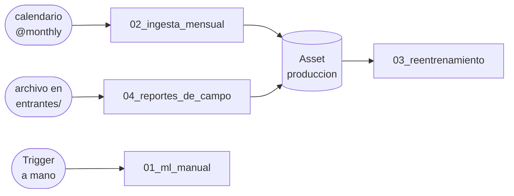

# Clase: Orquestación con Apache Airflow

Cuatro DAGs, cada uno con **una forma distinta de dispararse** y un concepto central de Airflow. Todos trabajan con datos reales de producción de pozos de Vaca Muerta (Secretaría de Energía).

```bash
docker compose down -v      # (opcional) arrancar de cero
docker compose up -d
```

Airflow: **http://localhost:8080** (`airflow` / `airflow`). Tarda ~1 minuto en levantar.

| DAG | Se dispara... | Concepto | Arranca |
|---|---|---|---|
| `01_ml_manual` | a mano, con un formulario | TaskFlow, XCom, paralelismo, params | activo |
| `02_ingesta_mensual` | por calendario | intervalos de datos, catchup, idempotencia, reintentos | **pausado** |
| `03_reentrenamiento` | cuando cambian los datos | Assets, branching, registro de modelos | activo (espera datos) |
| `04_reportes_de_campo` | cuando llega un archivo | sensor diferido, tareas dinámicas, cuarentena | **pausado** |



- **[GUIA-AIRFLOW.md](GUIA-AIRFLOW.md)**: guía paso a paso, DAG por DAG, para seguir la clase por tu cuenta.
- Para probar el DAG 4: `cp ejemplos/reportes/*.csv entrantes/`

## Estructura

```
├── docker-compose.yml        # postgres + airflow (api-server, scheduler, dag-processor, triggerer)
├── dags/                     # los 4 DAGs (se recargan solos al editarlos)
├── datos/fuente/             # la "fuente oficial": muestra del dataset de Energía (2023-2026)
├── datos/generar_muestra.py  # cómo se armó esa muestra
├── ejemplos/reportes/        # reportes de campo para soltar en entrantes/ (uno viene roto)
└── entrantes/                # carpeta que vigila el DAG 4
```

El lake (`/opt/airflow/lake`), los logs y la base de Airflow viven en volúmenes de Docker: `docker compose down -v` los borra todos.
