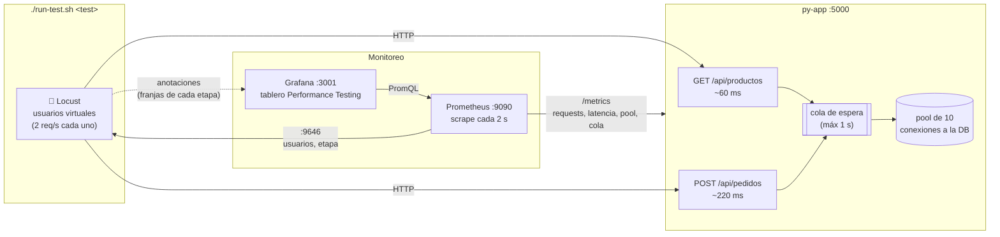
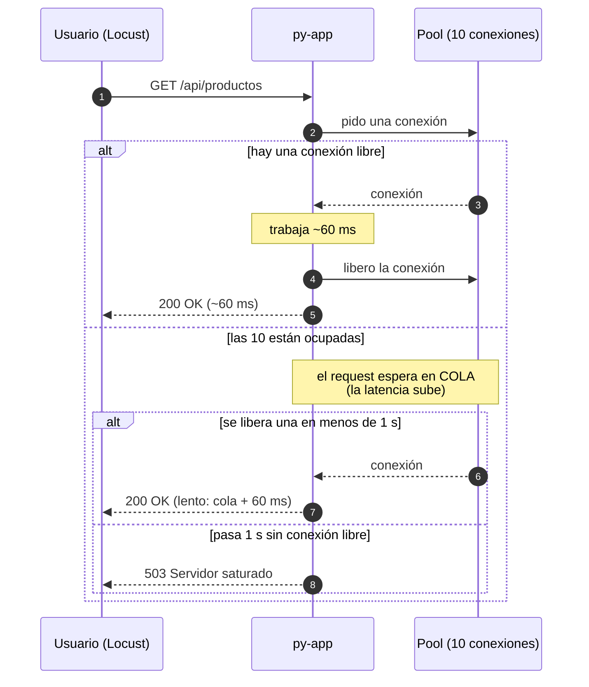
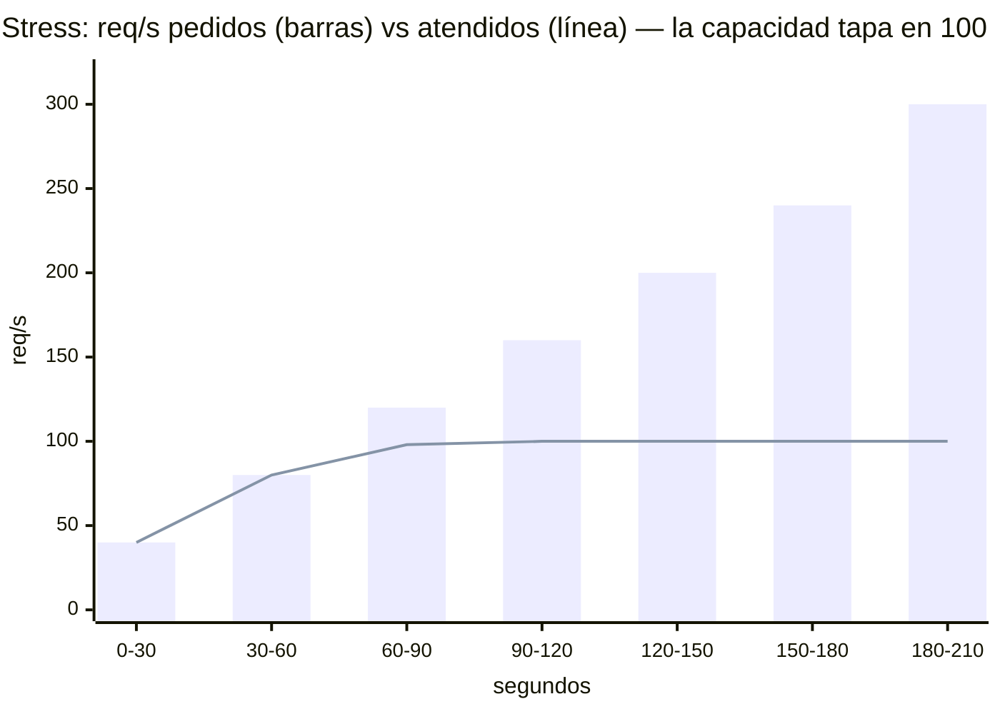

# La tienda: el sistema bajo prueba

`py-app` es una API mínima de una tienda online (FastAPI). Tiene dos endpoints "de negocio" y una **capacidad limitada a propósito**, para que los tests de performance den resultados nítidos y repetibles.

| Endpoint | Qué hace | Tiempo de servicio | Mezcla de tráfico en los tests |
|---|---|---|---|
| `GET /api/productos` | lista productos (lectura liviana) | ~60 ms | 3 de cada 4 requests |
| `POST /api/pedidos` | crea un pedido (escritura) | ~220 ms | 1 de cada 4 requests |
| `GET /health` | ¿está viva? | inmediato | solo smoke |
| `GET /metrics` | métricas para Prometheus | inmediato | Prometheus cada 2 s |

## Arquitectura



## Qué pasa con cada request



## La cuenta que explica todo

```
capacidad = 10 conexiones / 0.1 s por request (promedio de la mezcla 3:1) = ~100 req/s
carga     = usuarios × 2 req/s
→ el sistema se satura con ~50 usuarios
```

| Usuarios | req/s pedidos | Uso del pool | Qué pasa |
|---|---|---|---|
| 20 | 40 | 40% | 🟢 todo inmediato |
| 30 | 60 | 60% | 🟢 todo inmediato (load test) |
| 40 | 80 | 80% | 🟢 casi sin cola |
| 50 | 100 | 100% | 🟠 al límite |
| 60–80 | 120–160 | 100% | 🟠 se forma cola → **latencia > 500 ms** (rompe el SLA) |
| 100+ | 200+ | 100% | 🔴 la espera llega a 1 s → **503** |

## Por qué se rompe "después de X tiempo"

La API no se rompe por el tiempo que pasa: se rompe cuando **la carga pedida supera la capacidad**. En cada test eso ocurre en un momento distinto porque la forma de la carga es distinta:

| Test | Cuándo se rompe | Por qué |
|---|---|---|
| **smoke** | nunca | 1 usuario = 2 req/s, 2% de la capacidad |
| **load** | nunca | 30 usuarios = 60 req/s, 60% de la capacidad |
| **stress** | **t = 60 s** se rompe la latencia · **t ≈ 120 s** aparecen los 503 | a los 60 s sube a 60 usuarios (120 req/s > 100); a los 120 s llega a 100 usuarios y las esperas alcanzan 1 s |
| **spike** | **t = 60 s**, durante 45 s | salta de 20 a 200 usuarios (400 req/s, 4× la capacidad); al volver a 20 se recupera **en segundos** |



Desde que las barras pasan la línea, todo lo que sobra se convierte en **cola** (más latencia) y después en **503**.

Las perillas están en `docker-compose.yml` → `py-app.environment`:
- `DB_POOL_SIZE` (10): más conexiones = más capacidad → el quiebre llega más tarde.
- `QUEUE_TIMEOUT` (1.0): cuánto espera un request antes del 503.

## Demo: romper el smoke test

El smoke test es el **gate del PR**: valida que cada endpoint responda lo correcto. Para mostrarlo fallando:

1. En `py-app/app.py`, dentro de `listar_productos`, **descomentar**:

   ```python
   # raise HTTPException(status_code=500, detail="Bug introducido para la demo")
   ```

2. Reconstruir la API y correr el smoke:

   ```bash
   docker compose up -d --build py-app
   ./run-test.sh smoke
   ```

3. Resultado:

   ```
   Veredicto del test 'smoke': ❌ FALLA (errores = ~20%)
   GET /api/productos: status 500, se esperaba 200
   ✘ Test 'smoke' FALLÓ (exit code 1)
   ```

   En un PR, el workflow **Smoke test** queda en rojo con ese mismo mensaje.

4. Volver a comentar la línea y `docker compose up -d --build py-app` → vuelve a pasar.

> Variante: comentar el decorador `@app.get("/api/productos")` → el endpoint deja de existir y el smoke falla con `status 404, se esperaba 200`.
