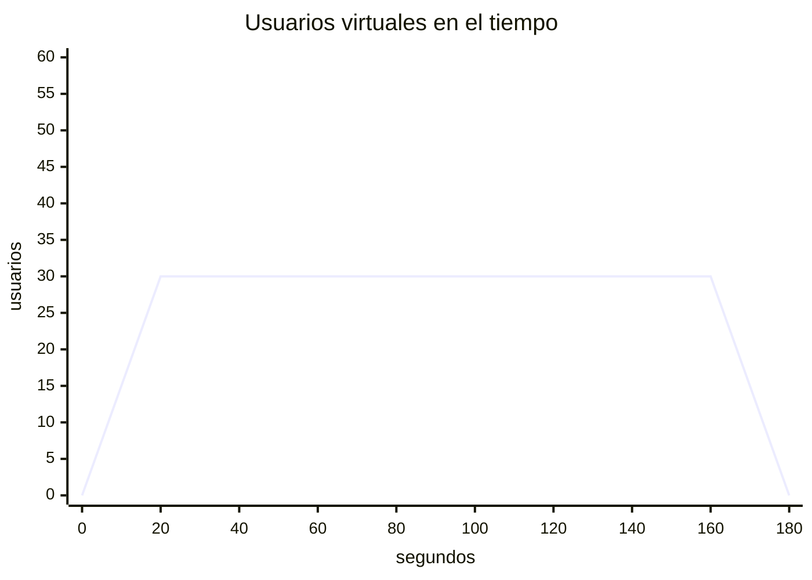
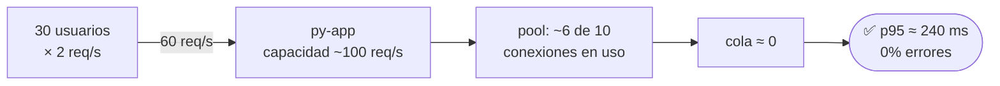

# Load test — "¿aguanta un día normal?"

```bash
./run-test.sh load      # ~3 min
```

**Qué es:** se aplica la carga **esperada** (30 usuarios ≈ 60 req/s = 60% de la capacidad) de forma sostenida y se verifica que se cumpla el SLA. Tiene veredicto: **pasa o no pasa** (exit code 1 si no cumple).

## Forma de la carga



| Etapa | Usuarios | Duración | req/s pedidos |
|---|---|---|---|
| rampa | 0 → 30 | 20 s | 0 → 60 |
| carga normal | 30 | 140 s | 60 (capacidad: 100) |
| bajada | 30 → 0 | 20 s | 60 → 0 |

## Flujo



## Resultado esperado

```
  Etapa                  Usuarios    Req/s   p50 ms   p95 ms   Errores   SLA
  rampa                        30     31.0       64      238      0.0%   ✅
  carga normal                 30     59.9       65      236      0.0%   ✅
  bajada                        0     29.2       64      235      0.0%   ✅
  Veredicto del test 'load': ✅ PASA
```

**En Grafana:** una **meseta aburrida**. Todo plano, latencia muy por debajo de la línea roja, cero errores, cola en 0. *Aburrido = sano.*
