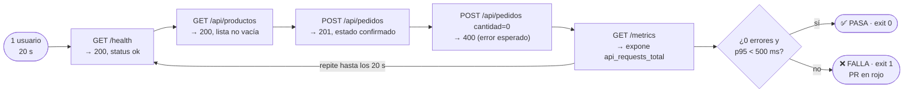

# Smoke test — "¿prende?"

```bash
./run-test.sh smoke     # ~20 s
```

**Qué es:** la prueba más chica posible. **1 usuario** recorre **todos** los endpoints en orden durante 20 s y valida status code **y contenido** de cada respuesta. No mide performance: verifica que el sistema funcione. Si el smoke falla, no tiene sentido correr nada más.

Corre en **cada Pull Request** (`.github/workflows/smoke-test.yml`): si falla, el PR queda en rojo.

## Flujo



## Resultado esperado

```
  Etapa      Usuarios   Req/s   p50 ms   p95 ms   Errores   SLA
  smoke             1     2.3        3      ~225      0.0%   ✅
  Veredicto del test 'smoke': ✅ PASA
```

**En Grafana:** casi nada, una línea bajita. Esa es la idea.

## Demo: romperlo a propósito

En `py-app/app.py`, dentro de `listar_productos`, descomentar:

```python
# raise HTTPException(status_code=500, detail="Bug introducido para la demo")
```

y reconstruir: `docker compose up -d --build py-app`. Ahora `./run-test.sh smoke` termina con **❌ FALLA (exit code 1)** y el error `GET /api/productos: status 500, se esperaba 200`. Ver [TIENDA.md](../../TIENDA.md#demo-romper-el-smoke-test).
