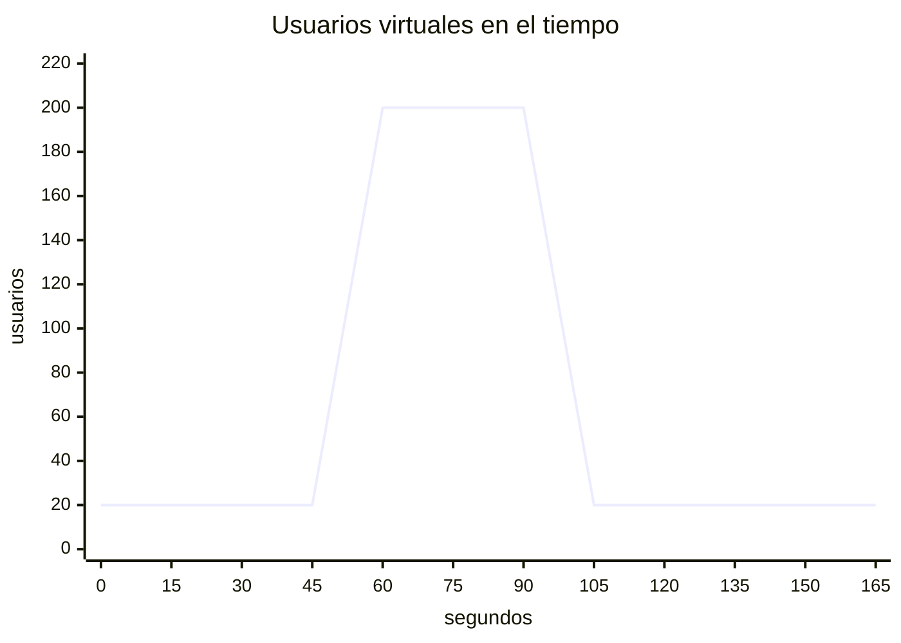
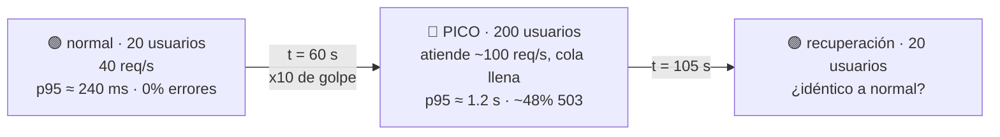

# Spike test — "¿sobrevive a un pico y se recupera?"

```bash
./run-test.sh spike     # ~2.75 min
```

**Qué es:** un pico **abrupto** de tráfico (una promo, un link viral): de 20 a 200 usuarios **en 1 segundo**. Importa qué pasa durante el pico, pero sobre todo si el sistema **vuelve solo a la normalidad** cuando termina. Exit 0 (exploratorio).

> Diferencia con stress: el stress sube **de a poco** para encontrar el límite; el spike salta **de golpe** para ver la reacción y la recuperación.

## Forma de la carga



| Etapa | Usuarios | Duración | req/s pedidos |
|---|---|---|---|
| normal | 20 | 60 s | 40 |
| **PICO** | **200** | 45 s | **400** (capacidad: 100) |
| recuperación | 20 | 60 s | 40 |

## Flujo



## Resultado esperado

```
  Etapa                  Usuarios    Req/s   p50 ms   p95 ms   Errores   SLA
  normal                       20     39.9       65      236      0.0%   ✅
  PICO                        200    188.0     1008     1218     47.8%   ❌
  recuperación                 20     39.9       64      238      0.0%   ✅  ← idéntico a "normal"
```

**En Grafana:** un bloque rojo entre dos zonas **idénticas**. Si después del pico la latencia o los errores quedaran altos (conexiones que no se liberan, memory leak, colas que no se vacían), el sistema tendría un problema aunque el pico ya haya pasado.
