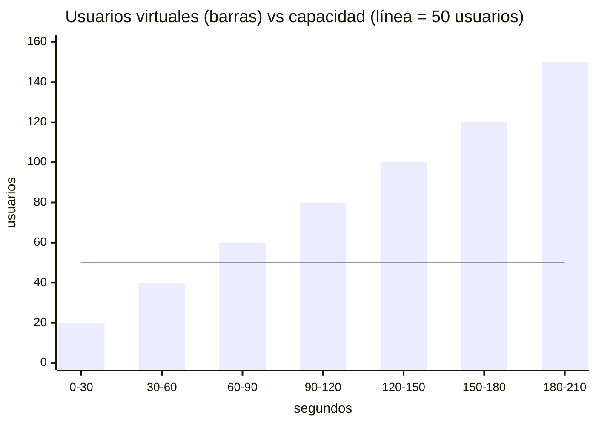
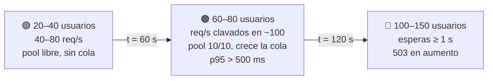

# Stress test — "¿dónde se rompe?"

```bash
./run-test.sh stress    # ~3.5 min
```

**Qué es:** se sube la carga **por escalones**, más allá de lo esperado, hasta encontrar el **punto de quiebre**. No tiene pasa/no pasa (exit 0): el resultado es saber **cuánto aguanta** y **cómo se degrada**.

## Forma de la carga

Escalones de 30 s. Cada usuario pide 2 req/s → la capacidad de la API (~100 req/s) equivale a **~50 usuarios**.



## Flujo: las tres zonas



## Resultado esperado

```
  Etapa                  Usuarios    Req/s   p50 ms   p95 ms   Errores   SLA
  20 usuarios                  20     40.2       64      236      0.0%   ✅
  40 usuarios                  40     79.6       67      241      0.0%   ✅
  60 usuarios                  60     98.0      558      748      0.0%   ❌  ← se satura
  80 usuarios                  80     99.8      790      980      0.0%   ❌
  100 usuarios                100    102.9      962     1144      0.8%   ❌  ← empiezan los 503
  120 usuarios                120    113.6     1038     1208     11.7%   ❌
  150 usuarios                150    136.4     1046     1218     29.4%   ❌
```

**En Grafana:** una escalera. Los req/s atendidos (verde) suben con los usuarios y se **aplanan en la línea de capacidad**; desde ahí, más usuarios = solo más espera y más rojo. La CPU queda baja: el cuello de botella es el pool, no la CPU.

> Preguntas para la clase: ¿con cuántos usuarios se rompe? ¿Qué se rompe primero, latencia o errores? ¿Por qué la CPU no avisa?
